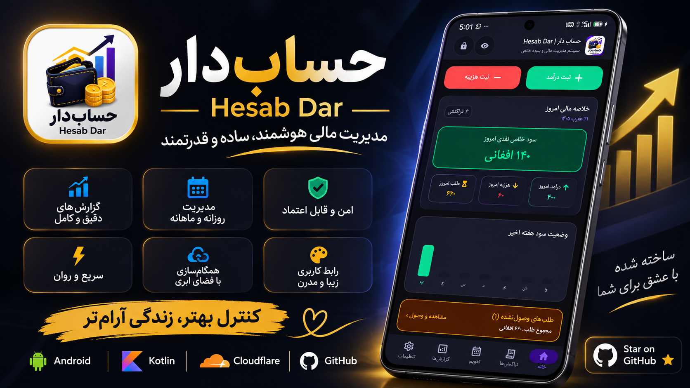

Hesab Dar | حساب‌دار

  

<h2 align="center">Your Money. Your Records. Your Control.</h2>

  An Offline-First Personal Finance Manager

  
  
  
  

---

About Hesab Dar

Hesab Dar is a personal finance application built to make income and expense management simple, accurate, and accessible.

It is designed for employees, daily workers, drivers, freelancers, and anyone with regular or irregular income.

Track your money, manage unpaid earnings, monitor expenses, and understand your financial situation — all in one place.

Key Features

<table>
<tr>
<td width="50%" valign="top">Income Management

- Record daily income
- Track received payments
- Manage unpaid earnings
- Keep payment records organized

</td>
<td width="50%" valign="top">Expense Management

- Record daily expenses
- Organize expense categories
- Add notes to transactions
- Review spending history

</td>
</tr>
<tr>
<td width="50%" valign="top">Financial Reports

- Calculate net profit
- Review financial performance
- Filter reports by date range
- Share reports as images or text

</td>
<td width="50%" valign="top">Personalization

- Persian and English interface
- Light and dark themes
- Multiple calendar systems
- Simple and clear experience

</td>
</tr>
</table>Download Hesab Dar

  

Visit the "Releases page" (https://github.com/RayesNajib/HesabDar/releases) to download the latest available version.

Screenshots

  <i>Application screenshots will be published here.</i>

Privacy

Hesab Dar follows an offline-first approach. Your financial information is intended to remain on your device rather than requiring a permanent internet connection.

Language & Calendar Support

- Persian
- English
- Afghan Solar Hijri calendar
- Iranian Solar Hijri calendar
- Gregorian calendar

License

Hesab Dar is proprietary software.

Personal use is permitted under the terms of the included license. Unauthorized copying, modification, commercial distribution, or redistribution is prohibited.

Read the full "LICENSE" (LICENSE).

Developer

  <strong>Najibullah Mohammadi</strong>
   
  Creator & Developer of Hesab Dar
    
  <a href="https://najib-ullah.netlify.app">Official Website</a>
  &nbsp; · &nbsp;
  <a href="https://github.com/RayesNajib">GitHub Profile</a>

---

  <strong>Hesab Dar | حساب‌دار</strong>
   
  Take control of your finances.
    
  © 2026 Najibullah Mohammadi. All Rights Reserved.

